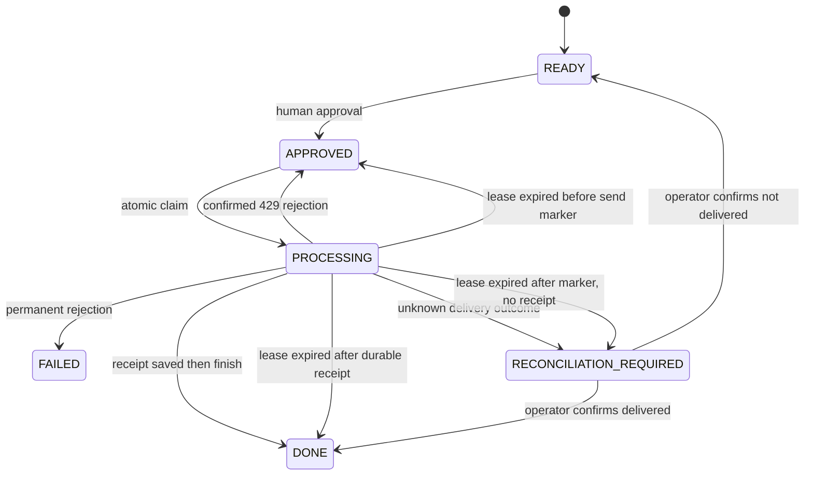

# Jarvis Return Worker — Railway Sandbox only

This service is a separate worker and does not import or call `server.py`, change CRM Booking, or enable Production delivery. Railway startup validates the exact Sandbox project/environment and the private Sandbox PostgreSQL identity. Deploy only the worker service in the `staging` environment of `Avtohirurg-Jarvis-Sandbox`.

## Telegram Transport

`JARVIS_TRANSPORT=telegram` enables Telegram Bot API `sendMessage`. It requires the Sandbox-only secret `JARVIS_TELEGRAM_BOT_TOKEN` and a single allowlisted `JARVIS_TELEGRAM_TEST_CHAT_ID`. A task destination must be `sandbox:telegram:<chat_id>` and must match that allowlist; other chats fail before any network request. Payload is plain text, up to 4096 characters. The transport uses a bounded timeout and does not retry HTTP calls automatically. Never copy Production bot credentials into Sandbox.

On success, the worker stores Telegram `message_id` as `external_message_id`, the chat identifier as `chat_id`, a stable `delivery_receipt`, and a minimized `delivery_response` containing only `{ok, message_id, chat_id}`. Telegram message text, user profile and sender data are discarded. Tokens, request URLs, response bodies and message content are excluded from logs.

Telegram's `sendMessage` has no idempotency-key parameter. The worker therefore guarantees at most one automatic request per approved action: it commits a send marker before the call, disables automatic network retries, and never repeats an `UNKNOWN` attempt. A timeout or HTTP 5xx can mean Telegram accepted the message; the task moves to `RECONCILIATION_REQUIRED` for an operator to check the test chat. This design cannot claim provider-level exactly-once delivery. An explicit HTTP 429 rejection is safe to retry after Telegram's `retry_after`; invalid token/chat and other definite 4xx responses fail permanently.

## State and delivery boundary

`FOR UPDATE SKIP LOCKED`, the lease owner and attempt counter fence concurrent/stale workers. Only an approved action can be claimed. Approval expires within 24 hours and the worker rechecks it before the send marker. Duplicate enqueue is idempotent by task ID, destination, payload fingerprint and correlation ID. Duplicate claims and finish operations cannot create another external request.

## Recovery after a crash

1. Before the durable send marker, lease recovery may return an action to `APPROVED` only while its approval remains valid and its attempt budget remains.
2. After the marker but before a receipt exists, recovery sets `RECONCILIATION_REQUIRED`. Do not requeue it until a human has checked the allowlisted test chat and explicitly resolves the outcome.
3. After receipt persistence, recovery sets `DONE` without contacting Telegram again.
4. For a confirmed delivery, call the approval-protected `/reconcile` with `outcome=delivered`, the receipt ID and message ID. For a confirmed non-delivery, call `/reconcile` with `outcome=not_delivered`; this clears the old approval and marker, and a human must approve again.
5. Never manually clear `delivery_started_at`, edit receipt identifiers, or infer non-delivery from a timeout/5xx.

## API, secrets and logs

`GET /health`, `/ready`, and authenticated `/metrics` are available. Other API reads require `JARVIS_READ_TOKEN`; state-changing approval, cancellation, requeue and reconciliation require the separate `JARVIS_APPROVAL_TOKEN`. Credentials are provided by Railway variables and must not appear in source, commit messages, logs, or reports. Access logs and OpenAPI are disabled.

Each completed attempt emits one JSON log with `task_id`, `correlation_id`, `attempt`, `lease_owner`, `provider`, `provider_message_id`, `state`, and `duration_ms`; it excludes bot token, chat message text, HTTP URL and response body.

## Metrics

`/metrics` exposes persisted queue gauges plus:

- `telegram_send_total`: Telegram requests attempted.
- `telegram_send_success_total`: accepted send responses.
- `telegram_send_failure_total`: confirmed retryable or permanent rejections.
- `telegram_send_unknown_total`: requests whose result needs reconciliation.
- `telegram_duplicate_prevented_total`: duplicate enqueue/started-send attempts blocked.
- `telegram_api_latency_seconds`: Telegram request latency histogram.

## Verification and rollback

Run `pytest jarvis-return-worker/tests`. PostgreSQL integration tests use only the ephemeral CI database in `JARVIS_WORKER_CI_DATABASE_URL`. Test Telegram traffic only in a dedicated test chat with a test bot. A restart test must confirm the same action remains `DONE` or `RECONCILIATION_REQUIRED` and no second network request is made.

Rollback only the Sandbox worker to a previously successful Sandbox deployment. Keep the additive database migration and audit history intact; do not revert/drop receipt columns or markers. No Production or CRM Booking resource is part of this service's deployment path.
